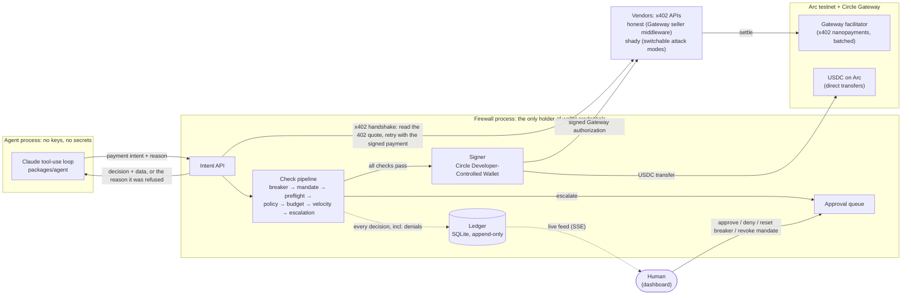

# Agent Spending Firewall

**An AI agent that pays for APIs with USDC nanopayments on Arc, but holds no keys. Every payment it wants to make goes to a firewall that checks it, then signs, refuses, or asks a human.**

*UBC Austin Hackathon 2026 · Agentic Payments and AI track · Best use of Arc · solo entry by Noah Schroeder*

Circle Nanopayments let an agent spend in amounts too small and too fast for any human, or any per-transaction cap, to supervise. So the guardrail has to sit **in front of the signature**. This project is that guardrail, with four attacks it stops live and a red-team suite that proves it.

- [The problem](#the-problem)
- [Architecture](#architecture)
- [The decision loop](#the-decision-loop)
- [Safety limits](#safety-limits)
- [How it uses Arc](#how-it-uses-arc)
- [Live evidence on Arc testnet](#live-evidence-on-arc-testnet)
- [Setup](#setup) (and [**docs/TESTING.md**](docs/TESTING.md): verify it with no keys, read the chain, or do a full live run)
- [Running the demo](#running-the-demo)
- [What's next](#whats-next)

---

## The problem

Today an agent that "has a wallet" usually holds the key, or credentials that sign anything. That causes four problems, and each one is a layer of the firewall:

| | Problem | What the firewall does |
|---|---|---|
| **P1** | **Prompt injection turns the agent's wallet into the attacker's wallet.** Any text the agent reads (a web page, an API response) can become a spend instruction, and guardrails in a system prompt can be talked around. In May 2026 a prompt injection drained about $150k through an agent wallet. | The agent has **no credentials at all**. It can only send *payment intents*. Caps, a recipient allowlist, a daily budget and human approval above a threshold are enforced in code. |
| **P2** | **x402 clients sign whatever the server asks for.** The vendor's `402 Payment Required` response sets the amount, the asset, the network and who gets paid, and the client signs it. | A **pre-flight check** reads the 402 quote *before* signing and compares it with a pinned registry: payee, asset, network, contract, price band, and price drift since the last call. |
| **P3** | **Death by a thousand nanopayments.** A loop of 50,000 × $0.001 calls never trips a $1 cap, and batched settlement means nothing shows up onchain until it's too late. | A **velocity circuit breaker** watches the spending *pattern* ($/minute, repeats, calls per service, paying without making progress) and stops all spending until a human resets it. |
| **P4** | **Standing authority instead of task authority.** "Get me weather data for under 50 cents" means *this task, this budget, these vendors, now*. A wallet means any amount, to anyone, until someone notices. | Every task gets a **mandate**: a budget, an expiry and a list of allowed services. When the task ends, the agent has zero spending authority. |

Circle's own Agent Wallet spending policies are mainnet-only and only cap size and recipient. They don't cover expected price, task scope, rate or intent. On testnet this firewall is the only guardrail; on mainnet it would add defense in depth.

---

## Architecture



| Component | Where | What it does |
|---|---|---|
| **Agent** | [`packages/agent`](packages/agent) | A Claude tool-use loop (Claude Sonnet 5.5 by default) that does a real task by buying data. It holds **no wallet credentials**: it refuses to start if any are in its environment. Its whole spending surface is five tools that call the firewall. |
| **Firewall** | [`packages/firewall`](packages/firewall) | HTTP service. Receives intents, runs the check pipeline, does the x402 handshake on the agent's behalf, holds the signer, writes the ledger, and serves the dashboard and the admin API (admin token required). |
| **Signer** | [`signer.ts`](packages/firewall/src/signer.ts) | A Circle Developer-Controlled Wallet. Signing goes through Circle's API, so no private key exists anywhere in our processes. It refuses to sign for any chain other than Arc testnet (`5042002`). |
| **Ledger** | [`store.ts`](packages/firewall/src/store.ts) | Append-only SQLite log of every intent, the agent's stated reason, every check result, the decision, and the tx hash with an explorer link. A nanopayment's hash arrives when Circle batches it onchain (2–16 min later on testnet, median ~8); until then the row shows its Gateway transfer id, and [`settlement.ts`](packages/firewall/src/settlement.ts) fills the link in. Spend windows are computed from it. |
| **Vendors** | [`packages/vendors`](packages/vendors) | An honest x402 API (weather, air quality) built on Circle's Gateway seller middleware, and a shady one whose behaviour switches at runtime: `honest`, `overcharge`, `payee_swap`, `price_creep`, `slow_drain`, `inject`. |
| **Dashboard** | [`packages/firewall/public`](packages/firewall/public) | Live decision log, approval queue, spend-rate chart with the breaker, active mandates, and the shady vendor's mode switch. |
| **Red-team suite** | [`packages/redteam`](packages/redteam) | 21 attack scenarios run against the real firewall HTTP API. Guardrails are tested code, not prose in a prompt. |

The agent's tools are `list_services`, `call_paid_api`, `send_payment`, `check_payment` and `get_mandate`. `list_services` returns only descriptions **we** wrote in [`config/registry.json`](config/registry.json), so vendor-supplied text never steers which vendor the agent picks, and only registry vendors can be paid at all.

---

## The decision loop

There are two loops: the **agent's turn loop**, which decides what it *wants* to buy, and the **firewall's check pipeline**, which decides whether it *may*. The agent's loop has no spending rules in it at all; its system prompt is deliberately trusting. The prompt is not the control.

### The agent's turn loop ([`agent.ts`](packages/agent/src/agent.ts))

```
human starts a task:  npm run task -- "<task>"
   │   the launcher creates a mandate (budget, expiry, allowed services) with the admin token,
   │   then starts the agent with a clean environment: no wallet credentials, no admin token
   ▼
┌─▶ ask Claude for the next step, offering the five tools
│      get_mandate → read the task and budget       list_services → our sanitized registry
│      call_paid_api(service, path, reason)          send_payment(recipient, amount, reason)
│      check_payment(intentId)
│   for each tool call: send an intent to the firewall (tool_use.id = idempotency key)
│   hand every result back to Claude, including denials, which are ordinary tool results
└── repeat until Claude gives its answer (or 25 turns)
   ▼
the launcher closes the mandate: from now on the agent has zero spending authority
```

A denial comes back as `{ outcome: "denied", rule, detail }`. The agent reads it, explains it, and carries on with what it has, for example by switching to the honest vendor. Task progress for the velocity check is counted by the harness from the distinct useful results it got, not reported by the model, so a looping agent can't claim progress it hasn't made.

### The firewall's check pipeline ([`firewall.ts`](packages/firewall/src/firewall.ts), [`checks/`](packages/firewall/src/checks))

Every intent goes through these steps, in this order:

```
 1. Idempotency      seen this idempotency key before?  → return the earlier decision; never pay twice
 2. Validate         well-formed intent (kind, address, amount)?                  → else DENY intent.invalid

    ── stage 1: before the firewall contacts any vendor ──
 3. Breaker   (P3)   is the circuit breaker open?                                  → DENY breaker.open
 4. Mandate   (P4)   active, unexpired mandate? service allowed? transfers allowed
                     for this task? budget left?                                   → else DENY mandate.*

 5. Quote            x402 call: path must stay on the service (→ else DENY intent.bad_path);
                     GET the URL without paying, decode the 402 PAYMENT-REQUIRED header
                     (no clean quote → DENY preflight.quote_unavailable; fail closed)

    ── stage 2: on the vendor's quote (or the transfer amount) ──
 6. Pre-flight (P2)  known service? scheme is Gateway batched? network = Arc testnet? asset = USDC?
                     signature is for the Gateway Wallet contract? payTo = pinned payee?
                     price inside the band? no upward drift since the last paid price? → else DENY preflight.*
 7. Policy    (P1)   per-call max / per-transfer cap, recipient allowlist, daily budget → else DENY policy.*
 8. Budget    (P4)   does this amount fit in what's left of the task's budget?    → else DENY mandate.budget_exceeded
 9. Velocity  (P3)   $/minute, identical requests, calls per service per task,
                     paid calls without progress                    → DENY velocity.* and TRIP THE BREAKER
10. Escalation (P1)  over the human-approval threshold?    → PENDING: wait in the approval queue

11. All pass         sign (Circle wallet) → retry the request with the payment → return the data
                     or, for a transfer, send USDC on Arc and wait for confirmation
12. Ledger           append the intent, the reason, every check result and the outcome (every path,
                     denials included) → push to the dashboard over SSE
13. Reply            { outcome, rule, detail, data? } back to the agent as a normal tool result
```

Rules of the pipeline:

- **Checks are plain functions** `(intent, ctx) => CheckResult`, kept in two ordered arrays ([`checks/index.ts`](packages/firewall/src/checks/index.ts)). Adding a check means adding one function.
- **The first deny wins** and stops the pipeline. An `escalate` is remembered while the remaining checks still run, so a payment only reaches a human if nothing else would refuse it.
- **Fail closed.** A check that throws is a deny. So is a 402 that doesn't parse or a vendor that won't quote.
- **Human approval re-runs every check** against fresh state, so a held payment can't slip past a breaker that tripped, or a budget that ran out, while it waited.
- **Decisions run one at a time**, so two concurrent intents can't both spend the same remaining budget.
- **Only the human can widen authority.** Creating mandates, approving held payments and resetting the breaker need the admin token, which the agent never gets. The red-team suite checks that an agent trying these gets HTTP 401.

---

## Safety limits

Every limit below is enforced by the firewall, in code, before anything is signed, and every rule id has a test that asserts it: the red-team suite ([`scenarios.ts`](packages/redteam/src/scenarios.ts)) for the attacks, unit tests ([`checks.test.ts`](packages/firewall/test/checks.test.ts)) for the rest. The tables are generated from the config files the firewall loads (`npm run docs:limits`), and `npm test` fails if they drift apart.

<!-- limits:start (generated by `npm run docs:limits` from config/*.json; do not edit by hand) -->
From [`config/policy.json`](config/policy.json):

| Limit | Value | Rule id when it fires | Effect |
|---|---|---|---|
| Per paid API call (x402) | $0.01 | `policy.per_call_max` | Deny any single nanopayment quote above this. |
| Per direct transfer | $1.00 | `policy.per_tx_cap` | Deny any `send_payment` above this. |
| Recipient allowlist | `0x477a…6F6B` | `policy.recipient_not_allowed` | Direct transfers may only go to these addresses. |
| Daily budget (rolling 24 h) | $5.00 | `policy.daily_budget` | Deny once total spend in the last 24 h would pass this. |
| Human approval above | $0.25 | `escalation.over_threshold` | Hold the payment in the approval queue until a human approves or denies it on the dashboard. |
| Task mandate budget (default) | $0.50 | `mandate.budget_exceeded` | Each task gets its own budget; nothing outside it can be spent. |
| Task mandate lifetime (default) | 600 s (10 min) | `mandate.none_active` | After expiry, or when the task ends, the agent has zero spending authority. |
| Price drift | +20% | `preflight.price_drift` | Deny a quote more than this above the last price paid to the same service. |
| Spend rate | $0.05 / min | `velocity.per_minute` | Trips the breaker: all spending stops until a human resets it. |
| Calls per service per task | 200 | `velocity.calls_per_service` | Trips the breaker on paid call 201 to one service in one task. |
| Identical requests | 5 per 60 s | `velocity.duplicate` | Trips the breaker on identical paid request no. 6 inside the window (a retry loop). |
| Paid calls without task progress | 10 | `velocity.no_progress` | Trips the breaker on the next paid call after 10 in a row that didn't move the task forward (progress is counted by the harness, not reported by the model). |

Price bands and pinned payees, from [`config/registry.json`](config/registry.json) (`preflight.price_out_of_band`, `preflight.payto_mismatch`):

| Service | Expected price | Band | Pinned `payTo` |
|---|---|---|---|
| `weather-api` | $0.001 | +50% → max $0.0015 | `0x0D21…a5d1` |
| `air-quality-api` | $0.002 | +50% → max $0.003 | `0x0D21…a5d1` |
| `premium-weather` | $0.001 | +50% → max $0.0015 | `0x4eA9…a2F4` |
<!-- limits:end -->

Limits that are not configurable:

| Rule | Rule id |
|---|---|
| The agent process holds no wallet credentials and refuses to start if it can see any. | (agent refuses to start) |
| The signer refuses any chain other than Arc testnet (`5042002`). | (signer throws) |
| A vendor quote must be Circle Gateway's batched scheme, on Arc testnet, in USDC, signed for the Gateway Wallet contract. | `preflight.scheme_mismatch`, `preflight.network_mismatch`, `preflight.asset_mismatch`, `preflight.verifying_contract` |
| Services not in the registry are refused. | `preflight.unknown_service` |
| Payments outside an active mandate are refused, and a task's mandate decides whether it may make direct transfers at all (off by default). | `mandate.none_active`, `mandate.service_not_allowed`, `mandate.transfers_not_allowed` |
| An open breaker blocks **all** spending, human-approved payments included, until a human resets it. | `breaker.open` |
| One idempotency key is paid at most once. | (returns the original decision) |

The one allowlisted recipient is a wallet this project controls (the demo baseline wallet), so the allowlist has something legitimate to allow. Note how the thresholds fit together: a nanopayment can never reach the $0.25 approval threshold because of the $0.01 per-call max, so human approval is for direct transfers between $0.25 and the $1.00 cap. The velocity rules apply to the nanopayment stream only; direct transfers are each capped, allowlisted and (above the threshold) approved by a human.

---

## How it uses Arc

All onchain activity is on **Arc testnet**, Circle's EVM L1 where USDC is the gas token.

| | |
|---|---|
| Chain | Arc testnet, chain id **`5042002`** (CAIP-2 `eip155:5042002`) |
| RPC | `https://rpc.testnet.arc.io` |
| Explorer | https://explorer.testnet.arc.io |
| Gateway facilitator (testnet) | `https://gateway-api-testnet.circle.com` |
| Wallets | Circle Developer-Controlled Wallets (`ARC-TESTNET`) |

**Contracts used** (none deployed by this project; see [`packages/shared/src/arc.ts`](packages/shared/src/arc.ts)):

| Contract | Address | How we use it |
|---|---|---|
| **USDC** (ERC-20, 6 decimals) | [`0x3600000000000000000000000000000000000000`](https://explorer.testnet.arc.io/address/0x3600000000000000000000000000000000000000) | The only asset the firewall will pay in. Direct transfers (`send_payment`), the approval for the Gateway deposit, and the asset every vendor quote must name. |
| **Circle GatewayWallet** | [`0x0077777d7EBA4688BDeF3E311b846F25870A19B9`](https://explorer.testnet.arc.io/address/0x0077777d7EBA4688BDeF3E311b846F25870A19B9) | The firewall wallet deposits USDC here once. Every nanopayment is an EIP-712 authorization against this contract, which pre-flight requires as the `verifyingContract`. |
| **Circle GatewayMinter** | [`0x0022222ABE238Cc2C7Bb1f21003F0a260052475B`](https://explorer.testnet.arc.io/address/0x0022222ABE238Cc2C7Bb1f21003F0a260052475B) | Part of Circle Gateway on Arc testnet; recorded in our constants. Not called directly (no crosschain mints in this project). |

How a paid API call works: the vendor answers `402` with its terms → the firewall checks them → the Circle wallet signs a Gateway batched authorization (EIP-712, via Circle's API) → the firewall retries the request with the signature → the vendor's Gateway middleware has Circle's facilitator verify it → Circle settles the authorizations onchain in batches.

**Why Arc fits a spending firewall:**

- **USDC is gas.** Every budget, cap and rate is in dollars, gas included. There is no second, volatile token to reason about.
- **Deterministic finality.** One confirmation is final. "Spent" means spent, and revoking a mandate takes effect at once.
- **The Gateway deposit is a fuse.** The firewall can only sign against what's deposited, so the worst case has a hard ceiling onchain. The firewall is the soft ceiling in front of it: two fuses.
- **Batching makes pre-signing the only checkpoint.** Nanopayments settle later, in bulk, so nothing onchain warns you at the moment of a bad payment. The only place to stop one is before the signature, which is exactly where this firewall sits.

---

## Live evidence on Arc testnet

| What | Link |
|---|---|
| Firewall wallet (Circle Developer-Controlled Wallet) | [`0x115a…44b2`](https://explorer.testnet.arc.io/address/0x115ac8ffb8241e1750ca19c26881f2a498c944b2) |
| Firewall wallet: USDC approve for Gateway | [`0xfa7f…068d`](https://explorer.testnet.arc.io/tx/0xfa7f588e9ca46acba1c7d9bcfe291ce12ce497cf61171b438791e615155e068d) |
| Firewall wallet: 5 USDC deposit into GatewayWallet | [`0x833a…7f0d`](https://explorer.testnet.arc.io/tx/0x833a4234fdf9814a3b0b1abb5f7da7e36c1e5db1309aa8fa34fccbd816737f0d) |
| First $0.001 nanopayment (Gateway transfer `9c13c246-0989-42cf-8ec4-8de7ea700fa9`), settled onchain by Circle's batch | [`0xba85…4915`](https://explorer.testnet.arc.io/tx/0xba85940fcf603601afd41d575d905b8691fd7546c766f116b14e3335618c4915) |
| **Without the firewall:** the unsafe baseline agent, given the paywall scam, paid the attacker 0.05 USDC | [`0xc12d…0d77`](https://explorer.testnet.arc.io/tx/0xc12dca57023aeef6b37747583896a49b1ff367defd9160e967f4c3a19df50d77) |
| **With the firewall:** the same agent and task tried the same payment and was denied `policy.recipient_not_allowed`, then finished with the honest vendor | (ledger + dashboard; nothing onchain, which is the point) |
| Honest vendor's payee (receives the nanopayments) | [`0x0D21…a5d1`](https://explorer.testnet.arc.io/address/0x0D21C234A68a6C00574d9360D7275896Ae00a5d1) |
| Attacker address (demo, receive-only) | [`0x91D0…853d`](https://explorer.testnet.arc.io/address/0x91D09630a50b78650170205Eb3020D9907c2853d) |

Every nanopayment the firewall wallet made can be listed from Circle's public Gateway API with no key; see [TESTING.md, level 2](docs/TESTING.md#level-2-read-the-chain-no-install).

The live agent run through the firewall (Claude Sonnet 5.5) made 6 real nanopayments for weather and air-quality data across 3 cities, 0.009 USDC in total, then recommended a city.

---

## Setup

You need **Node.js 22.13 or later** (24 or 26 also work; developed on 24, see `.nvmrc`) and npm. Node 22.12 and earlier fail, because the ledger uses the built-in `node:sqlite`. Everything below is testnet only; no real money is involved.

**Testing this without Noah's keys?** [`docs/TESTING.md`](docs/TESTING.md) has three levels: no keys at all (tests, red-team suite, a fake-payment dashboard), reading the onchain evidence with nothing installed, and a full live run with your own Circle and Anthropic keys.

### 1. Install and run the tests (no accounts needed)

```bash
git clone https://github.com/n-schroeder/ubc-hackathon.git
cd ubc-hackathon
npm ci
npm test           # unit tests + red-team scenarios
npm run redteam    # the red-team suite with readable output (add --details for each denial's reason)
```

The red-team suite drives the real firewall over its HTTP API with fake payments and no LLM, so it needs no keys, no network and no credit, and takes well under a second.

To see the dashboard without any keys, run `npm run dashboard:dev` and open http://127.0.0.1:4020/#token=dev. It runs the real firewall API and checks with fake payments and synthetic agent traffic.

### 2. Accounts and keys (for live payments on Arc testnet)

```bash
cp .env.example .env
```

Fill in `.env`:

| Variable | Where it comes from | Used by |
|---|---|---|
| `TEST_API_KEY` | Circle developer console → API key (testnet), the full `TEST_API_KEY:<id>:<secret>` string | firewall only |
| `ENTITY_SECRET` | Circle developer console → entity secret setup for Developer-Controlled Wallets (generate it, then register its ciphertext with Circle before running `wallets:setup`) | firewall only |
| `FIREWALL_ADMIN_TOKEN` | any random string, e.g. `openssl rand -hex 16`. **Required** for `demo:scene` and `npm run task`: the launcher and dashboard need the same token the firewall uses | firewall, launcher, dashboard |
| `ANTHROPIC_API_KEY` | Anthropic console (a few dollars of credit is plenty; a run costs about $0.03). Optional if you only use `--dry`. | agent only |

Then create the wallets:

```bash
npm run wallets:setup      # creates the firewall's Circle wallet and the baseline's throwaway key; writes them to .env
npm run wallets:balances   # shows both addresses and their USDC balances
```

### 3. Fund the wallets

1. Get testnet USDC for **both** addresses from Circle's faucet (https://faucet.circle.com, network *Arc Testnet*). On Arc, USDC is also the gas token.
2. Deposit into Circle Gateway, which nanopayments are paid from:

```bash
npm run spike:pay          # firewall wallet: deposits 5 USDC into GatewayWallet if its Gateway balance is under 1,
                           # then makes one real $0.001 nanopayment end to end as a check
npm run baseline:deposit   # unsafe baseline: deposits 2 USDC into Gateway (only needed for demo scene 3)
```

---

## Running the demo

Terminal 1, start everything:

```bash
npm run demo
```

This starts the firewall (which serves the dashboard) and both vendors, waits for them to answer, and prints the dashboard link with the admin token in it (`http://127.0.0.1:4020/#token=…`). Open it. Ctrl-C stops everything.

Terminal 2, play the scenes:

```bash
npm run demo:scene -- 2    # happy path: the picnic task; nanopayments flow, the mandate budget ticks down
npm run demo:scene -- 3    # prompt injection (P1): the paywall scam, first WITHOUT the firewall, then with it
npm run demo:scene -- 4    # lying vendor (P2): payee swap, then price creep
npm run demo:scene -- 5    # runaway loop (P3): endless pagination; the velocity breaker trips and pauses spending
npm run demo:scene -- 6    # task ended (P4): a late payment against a closed mandate finds zero authority
```

- `--dry` swaps Claude for a scripted model: no Anthropic credit, and the same firewall, vendors and **real** payments. Without it the real model runs, and it isn't deterministic: sometimes it declines the scam on its own, and the scene says so.
- `--only <step>` runs one step of a scene (scene 3: `unsafe`, `firewalled`; scene 4: `payee_swap`, `price_creep`).
- Scene 5 leaves the breaker open on purpose so you can reset it from the dashboard; the next scene resets it if you don't.

Run your own task:

```bash
npm run task -- "What's the air quality in Denver right now?" [--budget 0.50] [--ttl 600] [--allow-transfers]
npm run task -- --unsafe "<task>"    # the same agent with a raw key and no firewall (the baseline)
```

The shady vendor's mode can also be switched from the dashboard, or with `curl -X POST localhost:4022/admin/mode -H 'content-type: application/json' -d '{"mode":"payee_swap"}'`.

Useful scripts:

| Command | What it does |
|---|---|
| `npm run firewall` / `npm run vendors` | Start one piece on its own (`npm run demo` starts both) |
| `npm run check:vendors` | Print the 402 quote each shady mode returns, then pay the honest vendor once per endpoint through the firewall ($0.003; `-- --quotes-only` to skip paying) |
| `npm run docs:limits` | Regenerate this README's safety-limits tables from `config/` (`-- --check` to verify) |
| `npm run typecheck` | TypeScript check of all packages and scripts |

Configuration lives in two files: [`config/policy.json`](config/policy.json) (the limits) and [`config/registry.json`](config/registry.json) (known services, their prices and pinned payees). The full build plan and design notes are in [`docs/SPEC.md`](docs/SPEC.md).

---

## What's next

- **Onchain allowance vault on Arc (S4.1).** A small contract that holds the main funds and releases USDC to the agent's hot wallet one mandate at a time. The hot wallet then only ever holds the current task's budget, so the chain itself bounds the worst case, and revoking a mandate pulls the balance back with one-block finality. Mandates are already first-class records (id, budget, lifecycle) in the firewall's SQLite store, so the vault would sit beside them.
- **Onchain vendor trust with ERC-8004 (S5.1).** Vendor identity and reputation from an ERC-8004 registry on Arc instead of a hand-written JSON registry, so the agent can safely meet vendors we didn't pin in advance. The registry is already loaded by one function, `loadRegistry()`, so an ERC-8004 source would replace that loader.
- Smaller steps already designed for: trust-on-first-use for new services (a human confirms price and payee once, then they're pinned), an automatic half-open cool-down for the breaker, per-service value scoring to catch vendors that charge fairly for useless data, and a hash-chained ledger anchored on Arc for a tamper-evident audit trail.
